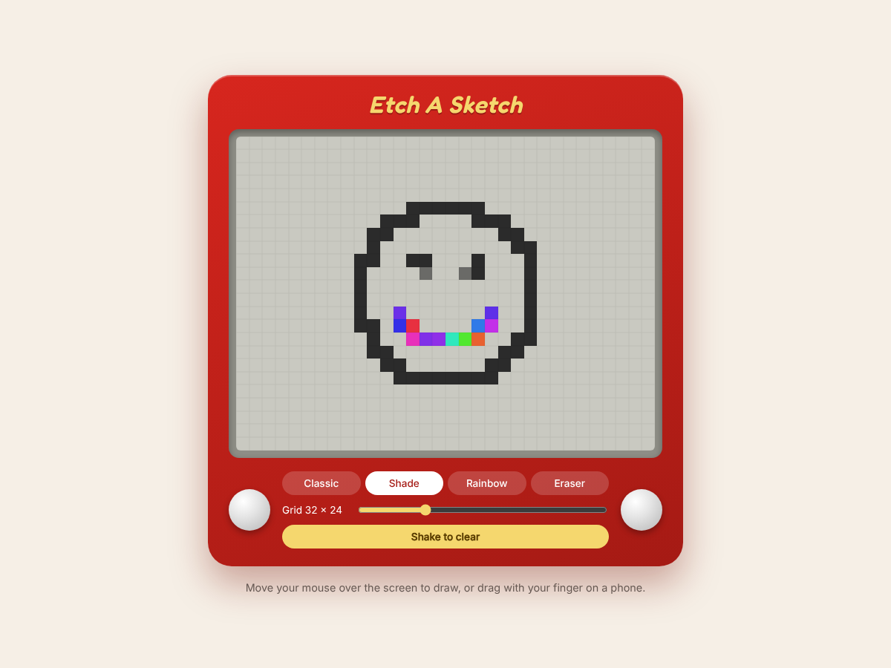

# Etch-A-Sketch

A browser version of the classic drawing toy, built with plain HTML, CSS and JavaScript with no libraries or build step.

**Live demo:** https://moenegm.github.io/etch_a_sketch/



## Features

- Draw by moving your mouse over the screen, or by dragging with your finger on a phone or tablet
- Four pens:
  - **Classic** draws in solid ink
  - **Shade** adds 10% more ink on each pass, so it takes ten passes to go fully dark
  - **Rainbow** picks a random color for every square
  - **Eraser** clears squares
- A grid-size slider from 8 to 100 squares across, which keeps the 4:3 screen shape
- **Shake to clear** shakes the toy and wipes the screen

## How it works

`main.js` builds the grid out of `div` cells inside a CSS grid. It uses Pointer Events, so one set of handlers covers mouse, touch and pen. A mouse draws on hover, like the original toy, and touch draws while your finger is down.

This started as a project from [The Odin Project](https://www.theodinproject.com/) curriculum.

## Run it locally

Clone the repo and open `index.html` in a browser.

```sh
git clone https://github.com/moenegm/etch_a_sketch.git
cd etch_a_sketch
open index.html
```
